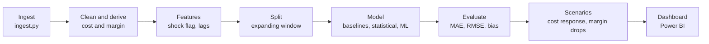

# Pipeline Sketch

## Stages

| Stage | What it does | Where it lives | Status |
| --- | --- | --- | --- |
| Ingest | Download and unpack the Statistics Canada table | `src/fpa/ingest.py` | Done |
| Clean and derive | Load the CSV, select 9 industries, derive cost and margin | `src/fpa/common.py`, `build_cost.py` | Started |
| Features | 2020 shock flag, lagged values, growth rates | `src/fpa/features.py` | To do |
| Split | Expanding-window validation, about 16 quarters for training and 10 for testing, no future data in training | `src/fpa/split.py` | To do |
| Model | Baselines (naive, drift), then statistical and machine learning candidates, chosen in M2 | `src/fpa/models.py` | To do |
| Evaluate | MAE, RMSE and forecast bias per industry and model | `src/fpa/evaluate.py` | To do |
| Scenarios | Cost response to revenue (RQ2) and margin under revenue drops of 5%, 10% and 20% (RQ3) | `src/fpa/scenarios.py` | To do |
| Dashboard | Management view of forecasts, margins and scenarios | Power BI, `dashboards/` | To do |

## Diagram

## Does it fit in seven days?

Yes, if scope is cut in this order whenever time runs short: first the
secondary questions (S1 to S3), then the machine learning model (keeping
the baselines and one statistical model), then dashboard polish (a single
Power BI page). The core that must be finished is: ingest, clean, split,
the baselines, one statistical model, evaluation, and the scenario table
for RQ2 and RQ3. All 9 industries run through the same code in a loop,
so adding an industry costs little. The main risk is time: after M1,
156 tracker steps remain for about 4 days, and writing steps are quick
while modelling and debugging are not.